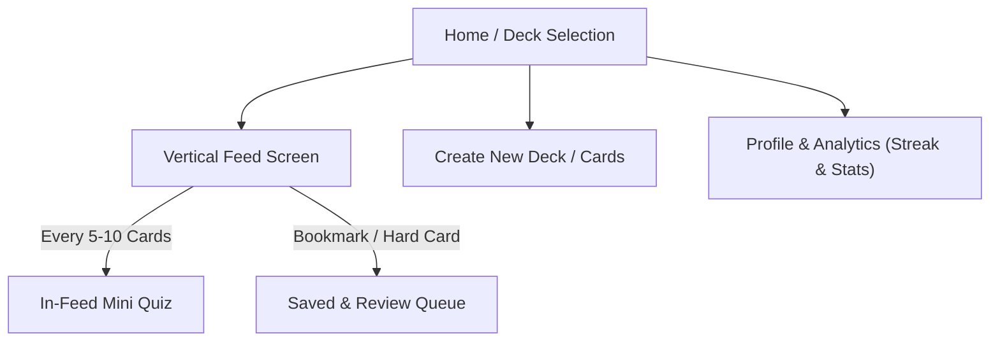

# 📱 ReelLearn — Vertical Micro-Learning Mobile App
### *Next-Generation Mobile Learning Platform Combining TikTok-Style Feeds with Spaced Repetition & Active Recall*

[](https://reactnative.dev/)
[](https://expo.dev/)
[](https://www.typescriptlang.org/)
[](https://opensource.org/licenses/MIT)
[](#)

---

## 📌 Project Overview

**ReelLearn** is an open-source mobile learning application designed for university students and lifelong learners, transforming traditional, static flashcards into an addictive **TikTok / Instagram Reels-style vertical feed experience**.

Instead of fighting mobile screen time habits, ReelLearn leverages them: merging seamless, swipe-based vertical browsing with evidence-based cognitive psychology principles—primarily **Spaced Repetition** and **Active Recall**.

---

## 🧠 Scientific & Pedagogical Foundations

| Learning Method | Description | Scientific Reference |
| :--- | :--- | :--- |
| **Spaced Repetition** | Scheduling reviews at scientifically calculated intervals just before the information is forgotten. Hard concepts appear frequently; easy ones appear spaced out. | *Hermann Ebbinghaus (Forgetting Curve), Sebastian Leitner (Box System), SuperMemo Algorithm* |
| **Active Recall** | Testing memory retrieval actively instead of passive reading. Users ponder the concept before flipping the card, supplemented with periodic mini-tests. | *Roediger & Karpicke (2006) — The Power of Testing Memory* |
| **Micro-Learning** | Chunking complex subject notes into high-impact, 15–30 second digestible bites. | *Cognitive Load Theory (John Sweller)* |
| **Gamification & Habit Loops** | Daily streaks, XP points, and achievement badges to establish long-term study habits rather than cramming. | *Yu-kai Chou — Octalysis Framework* |

---

## ✨ Key Features

- 🔄 **Vertical Learning Feed (Reels-style):** Full-screen interactive cards. Swipe up for the next concept, tap to reveal answers with smooth flip animations.
- 🎯 **"Understood" vs. "Review Again" Feedback:** Real-time feedback alters the card's interval and repetition weight.
- 🧩 **In-Feed Mini Quizzes:** Quick, interactive multiple-choice checkpoints appearing every 5–10 cards to reinforce retention.
- 📚 **Course & Topic Decks:** Organize study content by subjects (e.g., Python, Linear Algebra, Algorithms, Languages).
- ✍️ **Custom Deck & Card Creator:** Create custom cards with syntax-highlighted code snippets and markdown text.
- 📊 **Progress & Analytics:** Track study streaks, cards mastered, daily targets, and subjects requiring reinforcement.
- 💾 **Offline-First Storage:** Fast, persistent local storage via AsyncStorage / SQLite ensuring zero network latency.
- 🎨 **Modern, High-Contrast UI:** Built with sleek dark mode aesthetics, intuitive micro-animations, and accessible touch targets.

---

## 📱 Screen Architecture & User Flow

The application satisfies academic project criteria with **5 core screens and dedicated interaction flows**:



1. **Feed Screen (`FeedScreen`):** Full-screen vertical paging, tap-to-flip card animation, difficulty ratings (*Easy*, *Good*, *Hard*).
2. **Decks & Categories (`DeckListScreen` & `DeckDetailScreen`):** Browse topics, view card counts, and manage study sets.
3. **Mini Quiz Module (`QuizScreen`):** Multiple-choice knowledge validation triggered dynamically or on demand.
4. **Profile & Analytics (`ProfileScreen`):** Daily goals, consecutive day streak counters, mastery rates, and weak-topic analysis.
5. **Card Creator (`CreateCardScreen`):** Fast creation interface for adding custom notes, code snippets, and answers.

---

## 🛠 Technology Stack

- **Core Framework:** [React Native](https://reactnative.dev/) (v0.74+) with [Expo](https://expo.dev/) (SDK 51+)
- **Language:** [TypeScript](https://www.typescriptlang.org/) (Strict type safety and maintainable codebase)
- **Navigation:** [React Navigation](https://reactnavigation.org/) (Native Stack & Bottom Tabs)
- **Animations & Gestures:** [React Native Reanimated](https://docs.swmansion.com/react-native-reanimated/) & [Gesture Handler](https://docs.swmansion.com/react-native-gesture-handler/)
- **Local Persistence:** `@react-native-async-storage/async-storage` (Offline-first data persistence)
- **Icons:** `@expo/vector-icons` (Feather, Ionicons)
- **Date Calculations:** `date-fns` (Spaced repetition intervals and streak logic)

---

## 🗄 Data Model Schemas

```typescript
// Deck Model
interface Deck {
  id: string;
  title: string;
  description: string;
  category: string;
  color: string;
  cardCount: number;
  createdAt: number;
}

// Flashcard Model
interface Card {
  id: string;
  deckId: string;
  front: string;          // Question or concept prompt
  back: string;           // Explanation or solution
  codeSnippet?: string;   // Optional syntax code snippet
  difficulty: 'easy' | 'medium' | 'hard';
  repetitionCount: number;
  intervalDays: number;
  nextReviewDate: number; // Unix timestamp
  isBookmarked: boolean;
}

// User Progress & Gamification Model
interface UserProgress {
  streak: number;
  lastStudiedDate: string; // Format: YYYY-MM-DD
  dailyGoal: number;
  todayCompletedCount: number;
  totalCardsReviewed: number;
  xp: number;
}
```

---

## 🚀 Getting Started

### Prerequisites
- Node.js (v18.0.0 or higher)
- npm, yarn, or pnpm
- **Expo Go** mobile app on your physical device (available on iOS App Store & Google Play Store)

### 1. Clone the Repository
```bash
git clone https://github.com/Hkantosun/Mobile_application_project.git
cd Mobile_application_project
```

### 2. Install Dependencies
```bash
npm install
```

### 3. Start the Development Server
```bash
npx expo start
```

### 4. Run on Device / Simulator
- Scan the printed **QR code** in your terminal using the Camera app (iOS) or the Expo Go app (Android).
- Or press `i` for iOS Simulator / `a` for Android Emulator on macOS.

---

## 📁 Planned Project Structure

```text
├── assets/                 # Brand assets, logos, and custom fonts
├── src/
│   ├── components/         # Reusable UI components
│   │   ├── CardItem.tsx    # Full-screen vertical swipeable card
│   │   ├── FlipCard.tsx    # Smooth 3D card flip animation
│   │   ├── QuizItem.tsx    # Interactive multiple-choice item
│   │   └── StreakBadge.tsx # Gamification streak & XP badges
│   ├── screens/            # Application screen components
│   │   ├── FeedScreen.tsx
│   │   ├── DeckListScreen.tsx
│   │   ├── CreateCardScreen.tsx
│   │   ├── QuizScreen.tsx
│   │   └── ProfileScreen.tsx
│   ├── navigation/         # React Navigation stacks & bottom tabs
│   ├── services/           # AsyncStorage persistence layer
│   ├── utils/              # Spaced repetition algorithms (SM-2 / Leitner)
│   ├── types/              # TypeScript types & interface declarations
│   └── constants/          # Theme tokens, palette, and preloaded sample decks
├── App.tsx                 # Main application root
├── app.json                # Expo configuration file
├── package.json
└── tsconfig.json
```

---

## 🗺 Roadmap

- [x] Comprehensive architecture documentation & technical specification ([README.md](README.md))
- [ ] Initialize Expo + TypeScript foundation
- [ ] Implement Spaced Repetition engine (`spacedRepetition.ts`) and data contracts
- [ ] Develop local offline persistence layer (`storageService.ts`)
- [ ] Build vertical full-screen Reels feed (`FeedScreen`) with gesture-based navigation and flip animations
- [ ] Implement in-feed Active Recall Mini Quizzes (`QuizScreen`)
- [ ] Build Deck manager and custom Card creation screens
- [ ] Implement User Profile, daily study streaks, and visual analytics
- [ ] *Future Scope:* AI-driven automatic flashcard generation from uploaded lecture notes/PDFs via LLM integration

---

## 📄 License

Distributed under the [MIT License](LICENSE).
