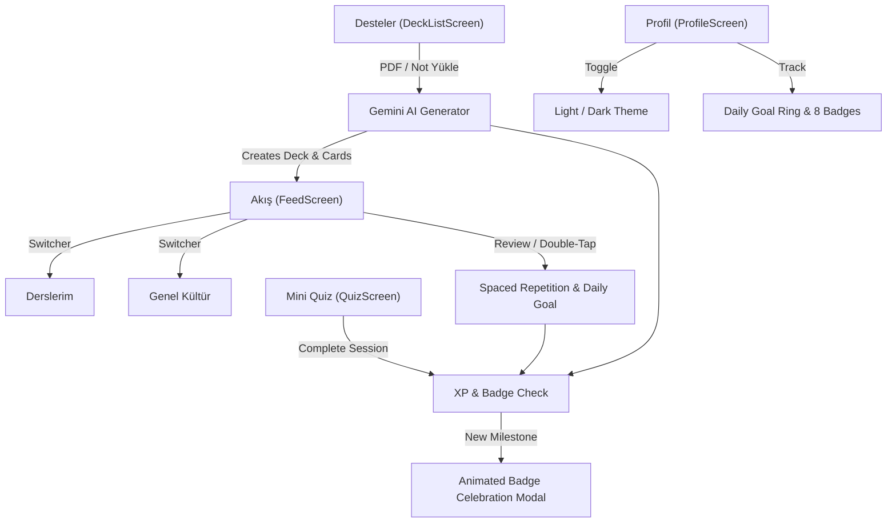

# 📱 ReelLearn — Vertical Micro-Learning Mobile App
### *AI-Powered Mobile Learning Platform Combining Reels-Style Vertical Feeds with Active Recall, Spaced Repetition & PDF-to-Flashcard Generation*

[](https://reactnative.dev/)
[](https://expo.dev/)
[](https://www.typescriptlang.org/)
[](https://ai.google.dev/)
[](https://opensource.org/licenses/MIT)
[](#)

---

## 📌 Project Overview

**ReelLearn** is a mobile micro-learning application built for university students and lifelong learners, transforming dense PDF lecture notes and study concepts into an engaging **Reels-style vertical flashcard feed**.

Instead of fighting mobile screen-time habits, ReelLearn channels them into focused learning—merging single-swipe vertical study cards with **Active Recall**, **Spaced Repetition**, **Google Gemini AI PDF analysis**, and **Gamified Achievement Badges** across both **Derslerim (Study Feed)** and **Genel Kültür (General Knowledge)** modes.

---

## 🧠 Scientific & Pedagogical Foundations

| Learning Method | Description | Scientific Reference |
| :--- | :--- | :--- |
| **Active Recall** | Every study card locks its hint and explanation until the learner selects one of 4 multiple-choice answers, actively engaging memory retrieval. | *Roediger & Karpicke (2006) — The Power of Testing Memory* |
| **Spaced Repetition** | Cards marked **Tekrar Et** or **Öğrendim** dynamically adjust their review intervals so difficult topics return sooner and mastered concepts space out. | *Hermann Ebbinghaus (Forgetting Curve), SuperMemo SM-2* |
| **Micro-Learning** | Breaking lecture notes and PDFs into focused 15–30 second interactive cards to minimize cognitive overload. | *Cognitive Load Theory (John Sweller)* |
| **Gamification & Habit Loops** | Daily goal rings, consecutive day streaks, XP progression, and 8 progressive achievement badges with animated celebrations. | *Yu-kai Chou — Octalysis Framework* |

---

## ✨ Key Features

- 🔄 **Dual Vertical Feed (`Akış`):**
  - **Derslerim:** Academic study flashcards & AI-generated decks from your own PDFs/notes.
  - **Genel Kültür:** Bite-sized general knowledge cards across science, history, philosophy, and culture.
  - Single-swipe vertical paging, 4-option inline multiple-choice with locked explanations, **Tekrar Et / Öğrendim** spring buttons, and **Instagram-style double-tap "Öğrendim!"** gesture.
- 🤖 **AI PDF & Lecture Note Analyzer (`Desteler`):**
  - Upload a `.pdf`, `.txt`, or `.md` file—or paste lecture notes directly—to automatically generate 4-option multiple-choice study decks via **Google Gemini 2.5 Flash**.
  - Generated decks are immediately saved locally and ready to study in the vertical feed.
- 🧩 **Interactive Mini Quiz (`Mini Quiz`):**
  - Timed active-recall quiz sessions pulled dynamically from your study cards, with instant explanations, accuracy summary, and XP rewards.
- 🏆 **8 Progressive Badges & Celebration Animations (`Profil`):**
  - Realistic, milestone-based badges (*İlk Kıvılcım, Hız Kazanan, Günün Şampiyonu, Akıllı Kütüphane, Koleksiyoncu, Seri Koruyucu, XP Avcısı, Usta Zihin*) with live progress bars.
  - Unlocking a new badge anywhere in the app triggers an animated celebration modal with pulsing halo and sparkle burst effects.
- 🌗 **Light & Dark Theme Switcher:**
  - Crisp **Sage & Forest Green** light palette and **Deep Forest** dark mode, toggleable directly from the Profile tab and persisted across restarts.
- ✨ **Animated Bottom Tab Bar:**
  - Spring-animated icons and active dot indicators on `Akış`, `Desteler`, `Mini Quiz`, and `Profil`.
- 💾 **Offline-First Persistence:**
  - Decks, cards, bookmarks, streaks, daily goals, badges, and theme preferences persist locally via `AsyncStorage`.

---

## 📱 Screen Architecture & User Flow



1. **Akış (`FeedScreen`):** Full-screen vertical card paging with `FeedHeaderTabs`, deck filter modal, bookmarks filter, inline 4-option quiz, and `QuizModal`.
2. **Desteler (`DeckListScreen`):** Searchable personal decks list, daily goal overview, and the **Akıllı Kart Üretici** (AI PDF/Note uploader).
3. **Mini Quiz (`QuizScreen`):** Dedicated timed quiz experience with progress bar, radio-card options, explanations, and results card.
4. **Profil (`ProfileScreen`):** Monogram profile hero, real-time stats grid, dynamic 0–100% circular Daily Goal gauge, 8 progressive badges, Dark Mode toggle, and profile editor.

---

## 🛠 Technology Stack

- **Core Framework:** [React Native](https://reactnative.dev/) with [Expo](https://expo.dev/) (Expo Go Compatible)
- **Language:** [TypeScript](https://www.typescriptlang.org/)
- **Navigation:** [React Navigation](https://reactnavigation.org/) (`@react-navigation/bottom-tabs`)
- **AI Integration:** Google Gemini API (`gemini-2.5-flash`) via `src/services/aiService.ts`
- **Document & File Handling:** `expo-document-picker`, `expo-file-system`
- **Local Persistence:** `@react-native-async-storage/async-storage`
- **Icons:** `@expo/vector-icons` (`Ionicons`)

---

## 🚀 Getting Started

### Prerequisites
- Node.js (v18.0.0 or higher)
- npm
- **Expo Go** app on iOS or Android

### 1. Clone the Repository
```bash
git clone https://github.com/Hkantosun/Mobile_application_project.git
cd Mobile_application_project
```

### 2. Install Dependencies
```bash
npm install
```

### 3. Configure Gemini AI Key (for PDF / Note Generation)
Create a `.env.local` file in the project root (ignored by git):
```env
EXPO_PUBLIC_GEMINI_API_KEY=your_gemini_api_key_here
```

### 4. Start the Development Server
```bash
npx expo start --clear
```
Scan the QR code with **Expo Go** (Android) or the Camera app (iOS).

---

## 📁 Project Structure

```text
├── assets/                     # App icons and splash assets
├── src/
│   ├── components/             # Reusable UI components
│   │   ├── FeedHeaderTabs.tsx  # Top bar, daily goal strip & dual feed switcher
│   │   ├── CardItem.tsx        # Vertical study card with 4-option quiz & animations
│   │   └── QuizModal.tsx       # In-feed active recall quiz modal
│   ├── constants/              # Seed data, badges & theme constants
│   │   ├── badges.ts           # 8 progressive badge definitions & evaluator
│   │   ├── initialData.ts      # Built-in study & general knowledge cards
│   │   └── theme.ts            # Spacing & typography tokens
│   ├── context/                # Global React contexts
│   │   ├── ThemeContext.tsx    # Light / Dark mode provider & AsyncStorage persistence
│   │   └── BadgeContext.tsx    # Global badge checker & animated celebration modal
│   ├── navigation/             # Bottom tab navigator with animated tab icons
│   │   └── RootNavigator.tsx
│   ├── screens/                # Main application screens
│   │   ├── FeedScreen.tsx      # Akış (vertical micro-learning feed)
│   │   ├── DeckListScreen.tsx  # Desteler (personal decks + AI PDF analyzer)
│   │   ├── QuizScreen.tsx      # Mini Quiz
│   │   └── ProfileScreen.tsx   # Profil (stats, daily goal ring, badges, dark mode)
│   ├── services/               # Persistence & AI services
│   │   ├── storageService.ts   # AsyncStorage CRUD & review logic
│   │   └── aiService.ts        # Google Gemini 2.5 Flash PDF/Note flashcard generator
│   ├── types/                  # TypeScript interfaces
│   └── utils/                  # Spaced repetition & progress calculations
│       └── spacedRepetition.ts
├── App.tsx                     # Root provider composition
├── app.json                    # Expo configuration
├── package.json
└── tsconfig.json
```

---

## 🗺 Roadmap

- [x] Dual-tab vertical Reels learning feed (`Derslerim` & `Genel Kültür`)
- [x] Spaced repetition engine & offline persistence (`AsyncStorage`)
- [x] 4-option Active Recall cards with locked hints & double-tap gesture
- [x] Google Gemini 2.5 Flash AI PDF & lecture note flashcard generator
- [x] Dedicated Mini Quiz screen with timer & XP rewards
- [x] Light & Dark theme switcher persisted locally
- [x] Animated bottom navigation tabs
- [x] 8 realistic progressive badges with animated unlock celebration modal
- [ ] *Next:* Wrong-answer review ("Hata Defteri") mode & PDF summary cheat-sheet generator

---

## 📄 License

Distributed under the [MIT License](LICENSE).
